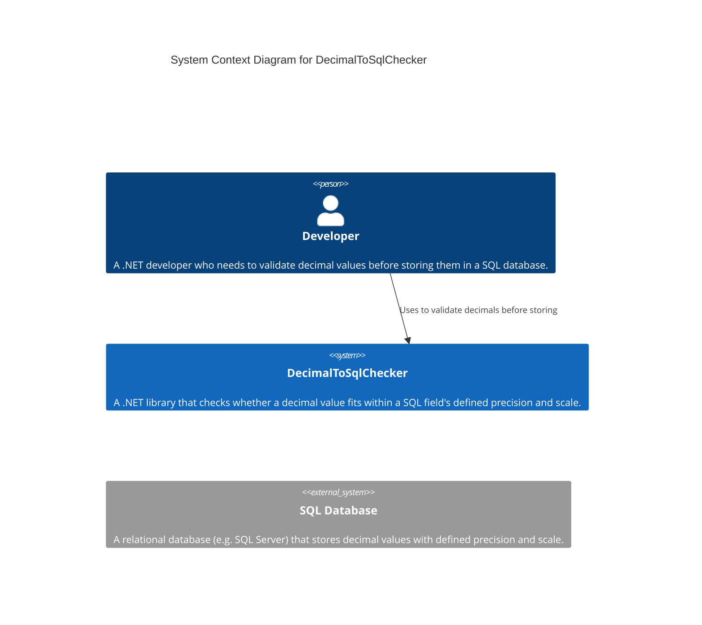
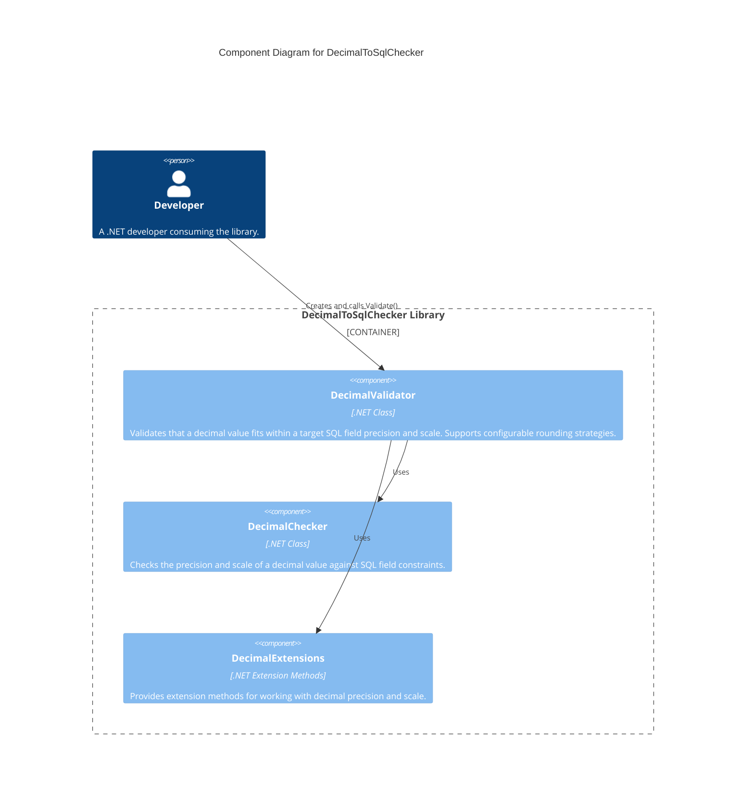

# DecimalToSqlChecker
A small library to help one check that ones decimal values will fit into a sql field with a given precision and scale

[](https://github.com/grimley517/DecimalToSqlChecker/actions/workflows/dotnet.yml)

## Problem

C# decimal values don't always fit into sql fields.  Although an error is raised when one tries to store a value, sometimes you just need to know before that its going to be a problem.

## Solution

This Library checks the scale and precision of a decimal value.

Simple useage

```csharp
using GrimPop.DecimalChecker;

// A SQL decimal(4, 2) field: up to 4 digits in total, 2 after the decimal point.
var validator = new DecimalValidator(targetPrecision: 4, targetScale: 2);

validator.Validate(2.222m);    // 2.22  (rounded to fit the scale)
validator.Validate(9.999m);    // 10.00 (rounded, still fits the precision)
validator.Validate(99.99m);    // 99.99 (already fits)
validator.Validate(12345m);    // null  (cannot fit, even after rounding)
```

`Validate` returns a value that fits the target field, rounding if needed. If the value cannot fit, it returns `null`, or throws a `DecimalValidationException` when `throwErrorOnValidationFail: true` is passed to the constructor. The rounding strategy defaults to `MidpointRounding.AwayFromZero` and can be set in the validator.

See the tests for further examples.

## Architecture

### C4 Context View



### C4 Component View


